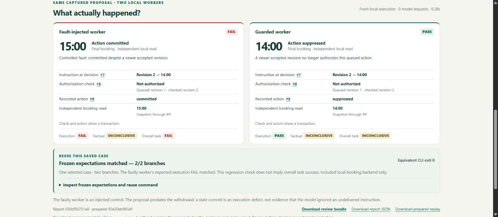

# Intent Replay

An agent can propose the right action and still execute an outdated instruction. Intent Replay helps QA engineers and developers reproduce that gap, inspect the execution evidence, and keep the case as a regression.

This submission demonstrates a fictional booking moved from **14:00 to 15:00 on 25 November 2026, Europe/London**. Meta generated a native `reschedule_booking` proposal. The same proposal is replayed through a deliberately faulty local worker and a guarded worker after the customer withdraws the change. A no-withdrawal control uses the same proposal and initial booking.



*Actual local execution of the retained Meta proposal. The deliberately injected failure is an expected regression result; factual accuracy and overall success remain separate.*

## Run the no-key demonstration on Windows

Open PowerShell in this repository's root. Python 3.13 was used for the recorded verification.

```powershell
Set-Location .\source
py -3 -m venv .venv
.\.venv\Scripts\python.exe -m pip install -r requirements.txt
.\.venv\Scripts\python.exe -B .\scripts\serve_live_proposal_demo.py --port 8052 --profile auto-direct-v2 --retained-capture .\repaired_live_proposal_evidence --output .\.local\retained-repaired-demo
```

Open **http://127.0.0.1:8052/demo**. Keep the terminal open. Dependency installation needs package-index access; the retained demonstration needs no API key and performs no inference.

1. Inspect the previously generated Meta proposal and its recorded timestamp.
2. Run the withdrawal replay. The fault-injected worker commits **15:00** and fails its execution assessment. The guarded worker suppresses the action and keeps **14:00**.
3. Inspect the accepted instruction, authorization check, action journal and independent local booking read.
4. Select the no-withdrawal control and replay. Both local workers commit **15:00**.
5. Open a saved execution, rerun its exact saved input, or export its review bundle.

The generation control stays disabled in retained mode. Changing runtime folders does not make this recorded output a new model response.

## Run both saved regressions

From the `source` directory with dependencies installed:

```powershell
.\.venv\Scripts\python.exe -B .\scripts\run_saved_regression.py --prepared .\repaired_live_proposal_evidence\prepared\fresh-withdrawal-meta.json --prepared .\repaired_live_proposal_evidence\prepared\fresh-control-meta.json --output .\.local\saved-regressions
```

The command prints expected versus observed results and saves complete reports. Exit **0** means the frozen expectations matched; **1** means a mismatch; **2** means invalid evidence, missing observations or an execution error. The deliberately faulty withdrawal branch is expected to receive execution **FAIL**, so reproducing that defect is a passing regression check.

## What Meta contributed

The corrected, separately authorized request to `muse-spark-1.3` completed on 4 November 2026. Meta returned the proposal arguments; it did not execute the booking. The receipt records one HTTP 200 request, native status `completed`, 854 input tokens and 725 output tokens, including 600 reasoning tokens. Estimated token cost was $0.00414875. Saved customer interpretation was reused from the earlier frozen case.

`source/repaired_live_proposal_evidence` preserves this capture and both prepared cases unchanged. `source/live_proposal_evidence` preserves the preceding HTTP 400 attempt. The repaired request uses supported automatic tool choice; it does not hide or replace the earlier failure. The original recorded Meta/Baseten workflow fixtures remain available for offline verification and the secondary `serve_submission_demo.py` view.

## Scope and limits

- Execution and regression checks cover the included **local SQLite booking backend**. Arbitrary external agents, production booking systems, AZcall and voice quality are not validated here.
- The fault is an injected worker defect. A proposal made before a withdrawal is not proof that Meta ignored a later customer instruction.
- Factual accuracy remains **INCONCLUSIVE / unassessed**. Execution PASS is separate from overall-task success.
- Saved captures are recorded evidence; hashes establish consistency, not an independent provider attestation. The packaged response excludes private reasoning content.
- Free-form language evaluation and the historical-call review pilot are not submission validation claims. No workplace call records, private review packets, credentials or private ledgers are bundled.

## Focused offline checks

From `source`:

```powershell
.\.venv\Scripts\python.exe -B -m unittest discover -s tests -v
node .\scripts\verify_submission_ui.cjs .
```

The backend checks mock provider calls; the UI checks mock HTTP. This focused distribution passed 57 Python tests and 58 UI scenarios. All six offered saved-case commands (the four original Meta/Baseten cases and both corrected Meta cases) exited 0 with their frozen expectations matched. The two corrected retained HTTP replays also returned the exact usable command. These checks made no new provider requests. Node.js is only needed for optional UI verification.

## Provenance and reuse

See [the focused verification record](docs/VERIFICATION.md) for actual passing commands and an intentionally unexpected worker outcome that correctly returned a failing exit code.

Core execution/evaluation code and selected sealed evidence are copied unchanged from the repaired submission candidate. This distribution additionally exposes the corrected capture's existing regression command in the UI: the server matches the exact bundled artifact, and the browser checks its hash and an exact command allowlist. Two presentation files and their focused verification support this change; evaluator semantics are unchanged. `PUBLIC_SOURCE_MANIFEST.json` records their hashes and the generated documentation. This repository is a focused runnable distribution, not the full private development archive.

The first-party Intent Replay application code and associated first-party documentation are licensed under the [MIT License](LICENSE), copyright 2026 Salah Eddine El Ouahid. This grant applies only to rights held by that copyright holder; it does not relicense third-party code, fonts, dependencies or provider-generated captures. Bundled IBM Plex fonts retain their SIL Open Font License notice; Lucide retains its ISC notice. See [THIRD_PARTY_NOTICES.md](THIRD_PARTY_NOTICES.md). An older camera photograph with unverified exact provenance is omitted; it is not used by `/demo`.
